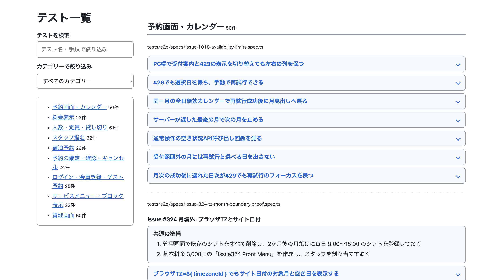
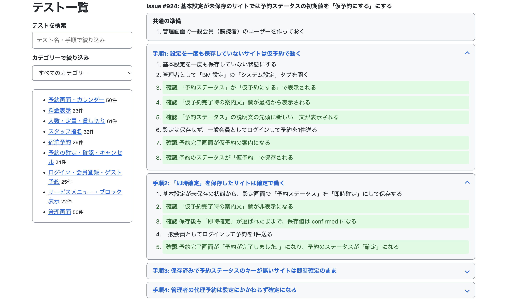

<!-- 
theme: vk-slide
size: 16:9
paginate: true
style: |
_paginate: false 
-->
<link href="./themes/vk-slide/fontawesome-free/css/all.css" rel="stylesheet">

# AIによる開発効率改善の取り組み

Gifu WordPRess MeetUp

石川栄和@Vektor,Inc.


<!-- _class: title -->


---

## 自己紹介 <span class="caption">- Self introduction -</span>


### 石川栄和

株式会社ベクトル

* プラグインの開発はほとんどAIで構築
* なるべく楽に効率よく開発できるように日々改善
* 個人的には自作の全自動並列AI駆動開発システムを使用

---

## 今日の内容

今日のお話は主に、開発効率を上げるためにどんなルールやスキル設定をしてるのか、あ。みなさんの環境でも取り入れられそうなポイントを紹介していきます。

---

<!-- _class: title-chapter  -->
<!-- _paginate: false  -->


# AI 駆動開発における前提
ルールとスキルの設定がとても重要

---

## ルールとは

AI に守ってもらう共通の基準。

* コーディング規約、ディレクトリ構成
* 関数・メソッド・クラス名などの命名規則
* デザインや CSS のルール
* テストの書き方
* コードだけでなく、コミットメッセージ、PR のタイトル・本文の書き方

rules ディレクトリ以下に各種ルールファイルがあるイメージ図

---

### スキルとは

* よく行う作業の手順書のようなもの
* /コマンドで簡単に呼び出せる

必要なルールを読み、どんな順番で作業し、何をもって完了とするかをまとめる。

* ルール：何を守るか
* スキル：どう進めるか

毎回指示していることをルールとスキルにする

---

例 : プルリクエストを出すスキル（ざっくり）

* ブランチを切って
* rules/change-title.md に沿ったコミットタイトルでコミットして
* rules/change-title.md に沿ったPRタイトルで
* rules/pr-description.md に沿った PR 本文で
* rules/changelog.md に沿って readme.txt の 
  changelog 部分に更新履歴を更新してコミット
* プッシュしてください！

みたいに毎回投げるの面倒 （＝ｗ＝

---

スキルにすると

`/vk-pr` 打てば上記の事を自動でやってくれるようになる

取り入れるポイント：
まずは自分が繰り返し指示している小さな作業を一つ、スキルにする。

---

## 実装とレビューで同じルールを参照する

* 守って欲しい事を、実装用スキルとPRレビュー用スキルに
  それぞれ書くと二重管理になる
* 片方だけ更新すると、実装とレビューで判断基準がずれる

共通のルールファイルを作り、両方のスキルから参照する
同じルールファイルを参照させる事でブレや二重管理を防げる

---

<!-- _class: title-chapter  -->
<!-- _paginate: false  -->


# issue 自動処理スキルを作る

---

* 仕様を検討して提案
* 実装
* PR作成
* コード品質・セキュリティレビュー
* UXレビュー
* ブラウザ動作テスト
* 問題点を修正 → 再レビューをループ
 
issue の URL を投げると一気に処理するスキルを
作成するために...

---

## 役割を持ったサブエージェントを定義する

* ディレクター（メインエージェント）
* 実装担当
* UI / UX担当
* ブラウザテスト担当
* コード品質・セキュリティ担当

役割ごとに、参照するルール・使うスキルをもった
サブエージェントを定義する

---

## 役割を分けるメリット

#### コンテキストを分離できる

それぞれ必要な専門知識だけを読み込ませられる

#### 並列で作業進められる

特定の機能追加について、
実装担当と UI / UX 担当が同時に検討して
それぞれの見解を issue にコメントするなど。

---

#### チェックの独立性が上がる

全部同じAIが、自分で実装して、自分でレビューするとレビューが甘いのでレビュー担当は完成した差分を第三者視点で確認。
「自分が書いたコードだから大丈夫」という前提を持たずに確認できる。

#### エージェントやモデルを変えられる

* 設計には性能のいいモデル、単純作業にはコストの低いモデルを割り当てたりできる
* 実装エージェントは Claude / レビューエージェントには Codex などを割り振る

---

## 作成したエージェント

| 名前 | 主な役割 |
|---|---|
| ディレクター| 全体の進行管理・担当者への割り振り |
| WordPressエンジニア | 主に WordPress 関連などプログラムの実装 |
| UXデザイナー | UI設計・UX・アクセシビリティ |
| レビュワー | Playwright によるブラウザ動作テスト |
| セキュリティ担当 | コード品質・セキュリティの最終レビュー |

---

エージェントの定義をしたら
issue を自動処理するスキルを作ります！

---

## issue 自動処理スキルを作る

* issue の URL を投げる
* ディレクターが中身を確認
  - 開発担当 / UX担当 / セキュリティー担当ん？ など、  
	必要なサブエージェントを起動して仕様検討・提案させる

---

* 明確な不具合修正や issue で既に仕様がしっかり固まっているものなど、人間の確認が不要
  → 自動で開発エージェントに実装指示 → 実装開始
* 仕様検討の結果人間に方針確認が必要
  → AI : issue に仕様提案をコメントに投稿
  → 人間 : 提案内容を確認・承認コメント
  → AI : 承認を検出 → 開発エージェントに実装指示 → 実装開始

---

* 実装完了したら  
  - PHPUnitテスト実行
  - 各種レビュー
    - セキュリティレビュー
    - UX レビュー
    - e2e テスト
  - 問題があれば差し戻して実装担当が修正 → 再レビュー

---

* 一通り完了を受け取ったらディレクターが
  /vk-pr スキルでプルリク作成
* ディレクターがプルリクのコメントで人間に最終報告

---

## こんな感じで issue 自動処理スキル完成！

GitHub の Claude に issue の URL を投げれば
自動で各種レビュー済みのプルリクまで出してくれる

`/vk-kore {url}` スキル（これやっといてスキル）爆誕！

---

## ちゃんと自動処理してもらうために

### issue に完了条件を書いておく

* 頭の中にある期待は、AI に伝わっていない
* 「どんな状態になれば完了か」を実装前に書く

脳内で「これ対応してもらうはずだったのに」と思っても
AIにとっては「そんなん知らんがな。書いとけや。」となる。

無駄な差し戻しや事前につぶしておきましょう。

---

<!-- _class: title-chapter  -->
<!-- _paginate: false  -->


# 改善の取り組み

---

<!-- _class: title-chapter  -->
<!-- _paginate: false  -->

# 人間の確認負荷軽減

---

<div style="font-size:42px;font-weight:bold;text-align:center;" >＿人人人人人人人人人人人人人人人人人＿<br>
＞　AIの書く文章がわかりにくすぎる！　＜<br>
￣Y^Y^Y^Y^Y^Y^Y^Y^Y^Y^Y^Y^Y^￣
</div>

<p style="margin-top:40px;text-align:center">issue への実装案、確認事項、PRでの確認事項など</p>


* 出てくる単語の意味がわからない
* 文量多すぎ
* 返答が必要な判断項目が多いと、
  どこまで返答したかわかりにくくなる。

---

### 対策1 重要な単語説明

いきなりわけのわからない単語を出されてもわからない。
決定事項にかかわる単語は、単語と概要を最初に表示

---


### 対策2 判断に必要な情報を先頭へ

特に人間判断が必要な issue や PR へのコメントの際は、
何を判断すればいいかわかりやすくなるようにルールを追加

---

```text
[ 前半に人間が最低限読むべき内容 ]

* 対応概要
* 確認してほしいこと
* 選択肢と推奨案

--------------------

[ 後半は技術情報など実装担当への引き継ぎ用 ]

* 技術仕様
* 影響するファイル
* テスト計画
```

前半だけ読めば返事ができ、後半は実装担当が仕様として読む。

<!-- 根拠: vk-agents commit 97ac55d -->


---

### 対策3 返信テンプレートを用意する

確認項目が多いケースで、長ったらしい確認項目を読んで、手動で順番に回答するのが大変

→ そのままコピペして返せる回答欄を付けるように

---

```text
1. ◯◯◯の表示方法
   回答: A / B / 推奨

2. ◯◯◯の初期状態
   回答: A / B / 推奨

3. 操作後の表示
   回答: A / B / 推奨
```

実際には「すべて推奨で」の一言で返信する事も多いが、確認事項が一覧しやすく、項目が置い場合も回答しやすい。

---

### 対策4 スクリーンショットの貼り付け

* AIが出してくる仕様提案で、文字でどう変更になるか書かれても脳内変換しないといけないのがストレス！
* PR出されても実機で手順通り操作して表示確認するのダルい！

実装案や PR での Before / After のスクリーンショット貼り付けるように設定

---

https://github.com/vektor-inc/vk-booking-manager-pro/issues/820

---

<!-- _class: title-chapter  -->
<!-- _paginate: false  -->

# トークン節約対策

---

## セッション自動切り替え

メインエージェントが長時間の作業と監視を抱えると、
コンテキストが膨らみ続けます。

1. 工程の区切りで引き継ぎファイルを作る
2. 会話を整理し、新しいセッションへ自動で切り替える
3. 現在のブランチと未コミット差分を確認する
4. テスト結果と残りの工程を引き継いで再開する

**最初からやり直さず、コンテキストだけを軽くします。**

---

これを実施した事により
１つの issue 処理でのトークン消費が...

# 約 ３分の１ に！

---

## サブエージェントのモデル自動選択

issue の内容に応じて難易度が異なる。
メインエージェントが難易度を判断、
サブエージェントを fable / Opus / Sonnet の
どれで起動するか指定する

---

## 定期的な見直し

高性能なモデルで、現状の構成をあらためてレビューさせて、
改善できるポイントを提案してもらい、改善する。

---

## テストの可読性を高める

AI で大量にテストも書かれるけれど、正直とても見てられない。

e2e の場合

* 手順・確認ごとにコメントを入れるようにルール化
* ビルド時に手順の確認事項を自動取得して、日本語で目視できるように

---



---



---

file:///Users/kurudrive/Documents/develop/dev/wordpress/wp-content/plugins/vk-booking-manager-pro/tests/test-catalog.html

---

<!-- _class: title-chapter  -->
<!-- _paginate: false  -->

# 独自アプリでの取り組み（おまけ）
VK Orchestrator

---

## VK Orchestrator

全自動並列AI駆動開発システムを自作し、
実際の開発に使っています。

処理対象として登録した GitHub issue をオーケストレーターが自動で拾い、Claude Code が一連の工程を進めます。

**仕様検討 / 実装 / レビュー・修正 / 各種テスト / PR作成**

複数のタスクを並行処理し、
作業ペインごとに進行状況を表示します。

---

## 実装の実行エンジンの切り替えを可能に

Claude Code の週間消費はカツカツ！
でも Codex は全然余裕がある →

実装のサブエージェントだけ Codex で処理するなど
設定切り替え可能に！

◯ トークンの状況を見て消費を分散できるようになった

---

## 各工程ごとに実行エンジンを変える

実装だけでなく各工程毎に実行エンジンを切り替えられるように

| 工程 | 割り当て例 |
|---|---|
| 実装 | Codex |
| UX・UIレビュー | Claude Code |
| コード・セキュリティレビュー | Codex |
| E2Eテスト | Claude Code |

利用枠の残り方に応じて工程単位で仕事を振り分ける

<!--
根拠: vk-agents README「環境別設定」の agents.engine / agents.model / agents.codex_model。
割り当ては一例。実際には各エージェントの設定で切り替える。
-->

---

## 各工程ごとに実行モデルを変える

実行エンジンだけでなく各工程毎に使用モデルを指定可能に

| 工程 | 割り当て例 |
|---|---|
| 実装 | Codex / Sol |
| UX・UIレビュー | Claude Code / Sonnet |
| コード・セキュリティレビュー | Codex / Astra|
| E2Eテスト | Claude Code / Sonnet |

単純な作業はコストの低いモデルを指定する

<!--
根拠: vk-agents README「環境別設定」の agents.engine / agents.model / agents.codex_model。
割り当ては一例。実際には各エージェントの設定で切り替える。
-->

---

## issue 単位で仕様検討のモデルを変える

実装前の仕様検討は一番重要。
複雑な issue は高性能なモデルを使いたい。

| issue | 指定 | Claude Code |
|---|---:|---|
| 大きい、複雑 | `high` | Fable |
| 通常 | `mid` | Opus |
| 軽い、実装方法が明確 | `low` | Sonnet |

実装・レビュー全体を重いモデルへ変えず検討工程だけ指定
※ Codexで仕様検討する場合は別の対応表を使います。

<!--
根拠: vk-agents rules/agent-launch.md と rules/agent-launch-codex.md の spec-model 対応表。
-->

---

## issue ごとにレビュー内容を選ぶ

すべての issue にすべてのレビューを実行すると時間もトークンも消費してしまう。

見た目の変更のない作業では UI・UX や e2e をスキップするなど、スキル側で指定はしてあるが、issue 単位でスキップ指定できるように

---

| issueの例 | 実行するレビュー |
|---|---|
| 文言、文字サイズ、色の変更など軽微な変更 | 重いレビューはスキップ |
| 条件分岐、権限、複雑な値の変更 | UX、セキュリティ、/code-review、CodeRabbitなどを指定 |

issue 毎に実行・スキップを選びます。

<!--
根拠: vk-agents README の review-ux / review-security / review-e2e / review-code-review / review-coderabbit。
-->

---

<!-- _class: title-chapter  -->
<!-- _paginate: false  -->
<!--  -->

# 複雑な issue の自動処理

---

従来 : 

* 複雑な issue は複数のサブ issue へ自動分割
* サブ issue を手動で順番に様子を見ながら実行承認

| 分割後に必要だった作業 | 人間の負担 |
|---|---|
| 未決の仕様を確認 | 各 issue を順番に読む |
| 依存関係とマージ順を判断 | 着手できる issue を選ぶ |
| 自動処理へ投入 | 1件ずつ実行待ちにする |
| 進行を監視 | 止まったペインへ声をかける |

---

### サブ issue も最後までAIが自動処理

1. 全サブ issue を読み、未決の仕様を先に人間に確認する
2. 依存関係とマージ順を整理する
3. 着手できるissueを自動マージON・実行待ちへ切り替える
4. 並行できる別リポジトリの issue を続けて投入する
5. 作業ペインを監視し、止まったり必要なら声をかける
6. 全サブ issue が完了まで見守る / 親 issue は自動クローズ

同じリポジトリでは衝突を避けて1本ずつ、
別リポジトリを跨ぐ場合は並行して進めます。

<!--
根拠: vk-agents skills/vk-kore-sub/SKILL.md、vk-orchestrator docs/agent-rules.md「サブ issue の続行」。
-->

---


**運用して面倒だった箇所を、順番に仕組みへ変え続けています。**

---

<!-- _paginate: false  -->

<center>

<p class="mt-48">ありがとうございました</p>


<!-- _class: title-chapter  -->
<!-- _paginate: false  -->

